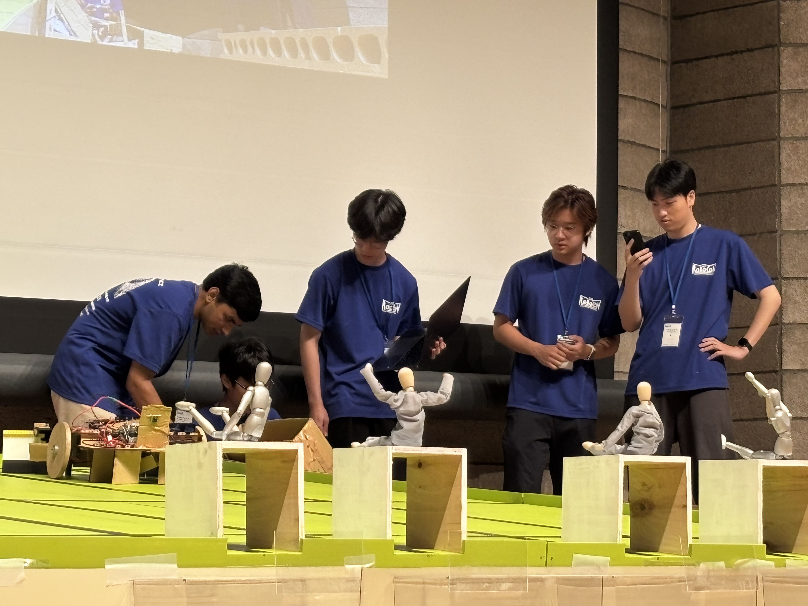

# IDC2026 Team Blue

### *AI to Science*를 위한 두 로봇 시스템

**Design Prize 수상 · IDC ROBOCON 2026 · 일본 도쿄과학대학 · 2026년 8월 10–22일**

[English](README.md) · [상세 보고서](docs/project_report.md) · [근거 자료와 보존 범위](docs/evidence.md) · [하드웨어 자료](hardware/README.md)



한국·인도·중국·일본·태국 출신 5명이 공을 대량으로 수집하는 수동 조종 로봇과,
영상으로 주행하고 공을 분류하는 자율 로봇을 제작했습니다. 두 로봇 사이의 운반에는
경기장 경사면과 중력을 활용했습니다.

이 저장소에는 인식·제어 소프트웨어, 합성 데이터 생성 과정, 학습 가중치, 선별한
제작 파일과 프로젝트 기록을 정리했습니다. **대회용 Raspberry Pi는 주최 측에
반납되었으며, 이 저장소는 당시 실행본 전체가 보존된 배포본이 아닙니다.**

## 결과

| 항목 | 결과 | 확인 범위 |
|---|---|---|
| 설계상 | **Design Prize** | [원본 상장](docs/evidence/design-prize-certificate.pdf)의 명칭을 따름. 심사 사유나 순위는 명시되지 않음 |
| 사이버 게임 | **2개 중 2개 득점** | 팀 보고서에 기록된 결과 |
| 대량 포획 | 시험에서 공 **55개 전부**를 여러 차례 포획 | 경기에서는 약 절반, 전부를 각각 포획했다고 보고. 배출·전달은 불안정 |
| 자율 동작 | 두 경기에서 주행·목표 형상 인식·골 정렬에 성공했다고 보고 | 공 전달 실패로 통합 득점은 검증되지 않음. 연속 분류는 별도 시험 결과 |

주요 실패 지점은 수집한 공을 자율 로봇에 넘기는 구간이었습니다. 배출부가 막혔고,
경사로를 통과한 소수의 공도 목표 구역에 안정적으로 도달하지 못했습니다. 바닥 없는
자율 로봇 구조 때문에 사이버 게임으로 얻은 추가 시작 공도 활용하지 못했습니다.

## 작동 원리

주황색 공은 **사람 형상이 있는 골**, 은색 공은 **로봇 형상이 있는 골**에 넣습니다.
매 경기 형상의 좌우 배치가 바뀌므로 영상 인식이 필요합니다. 한 골에 공이 여러 개
있고 모두 올바른 색이면 해당 골 점수가 두 배가 됩니다. 경기 시간은 3분입니다.


- **수동 조종 로봇:** 전자석을 해제해 바닥 없는 상자를 공 더미에 씌운 뒤, 포획한
  공을 끌고 이동합니다. 감속 기어를 단 모터와 약 40 cm 높이의 경사로로 공을
  올려 보냅니다. 제공된 Go2 대신 자체 플랫폼을 제작했습니다.
- **자율 로봇:** 서보 하나로 양쪽 팔을 펼치고, 비대칭 쐐기로 공을 한 줄로 모읍니다.
  별도 플랩이 막힘을 풀고 분류 플랩이 공을 두 출구로 나눕니다. Raspberry Pi 5와
  두 카메라가 형상 인식·레인 주행·공 색 분류를 담당합니다. 인코더 없이 영상과
  시간 제어를 사용했습니다.

## 합성 데이터 기반 형상 인식

팀 보고서에 따르면 대회 기간 중 약 **18,000장의 합성 렌더 이미지**를 생성했습니다.
현장 사진 약 **500장**은 Blender 재질·조명 보정에 사용했고, 검출기 학습에는 실제
사진을 넣지 않았습니다. URDF 인형 생성 → MuJoCo 자세 안정화 → Blender 렌더링과
가림 검사를 거친 라벨 생성 → YOLO11n 학습으로 이어지는 과정입니다.

[기존 실사진 평가](docs/lr_field_report.html)는 127장 중 제외 기준 적용 후 97장을
채점했으며, 합법적인 착석 자세의 81장을 주요 평가 대상으로 삼았습니다.

| 지표 | 결과 | 해석 |
|---|---|---|
| FP32 좌우 판정 사용 가능 프레임 | **69/81, 85%** | 정답 배치와 모순되지 않는 부분 검출도 포함 |
| 은색 로봇 검출의 올바른 분류 | **34/34** | 검출 단위 수치이며 재현율 100%를 뜻하지 않음 |
| 근거리 분류 정확도 | **100%로 보고** | 화면 높이의 약 24–25% 이상인 박스. 해당 부분집합의 표본 수는 미기록 |
| INT8 변환본 좌우 판정 사용 가능 프레임 | **65/81, 80%** | FP32와 구분해야 하는 별도 결과 |

원거리에서 사람을 로봇으로 오인하는 문제가 남아 있어, 제어 코드는 충분히 가까운
관측에서만 좌우 결정을 확정합니다. IMX500 변환 패키지는 보존되어 있지만, 경기
당일 센서 내부와 Pi CPU 중 어디에서 추론했는지는 확정할 수 없습니다.

## 자료 찾기

| 경로 | 내용 |
|---|---|
| [상세 보고서](docs/project_report.md) | 전략, 기구 설계, 경기 결과, 실패 분석과 개선 과제 |
| [근거 자료](docs/evidence.md) | 출처·수치 정의·사진·보존된 코드의 한계 |
| [ball_color/](ball_color/README.md) | 공 색 분류, 레인 추적, 진영·도착 판정 |
| [nav/](nav/README.md) | 주행·좌우 판정·미션 로직, ROS 2 제어 연결 |
| [dummy_model/](dummy_model/) · [models/](models/README.md) | 합성 데이터 생성 코드와 학습 가중치 |
| [hardware/](hardware/README.md) | Fusion 설계 원본, DXF, 선별 STEP 부품과 출처 목록 |
| [cad/](cad/README.md) | 파라미터 기반 CAD 표현과 재생성에 필요한 외부 자료 |

## 하드웨어 없이 실행하기

저장소 최상위 폴더에서 Python 3으로 실행합니다.

```bash
# 외부 패키지가 필요 없는 기존 로직 검사 25개
python nav/test_logic.py

# 공 색 분류 예제
python -m pip install -r requirements-offline.txt
python ball_color/ball_color_node.py --images 'ball_color/samples/*.png'
```

빈 포켓 기준 영상 없이 실행하면 흰색 예제도 `silver`로 분류됩니다. 은색과 흰색을
색만으로 구분하지 못하는 알려진 한계이며, [현장 보정 절차](ball_color/README.md)를
함께 확인해야 합니다.

보존된 실행 스크립트에는 외부 형상 검출 노드와 실제 배선 검증이 필요합니다.
경기에서 보고된 수신 위치 이동·대기 과정과 막힘 해소 플랩 제어 전체가 현재 코드에
복원되어 있지는 않습니다. [복원 범위](docs/evidence.md#what-this-repository-can-reproduce)를
확인한 뒤 사용하세요.

## 팀

상장에 기재된 팀원은 **Takato Inoue, Yuyang Gao, Koshy Prasanth, Minjoon Jang,
Soravit Satechaichan**입니다. 아이디어 선정은 공동 작업이었고 전기 조립·배선도
두 로봇에 걸쳐 분담했습니다. 제공된 포트폴리오는 Minjoon Jang의 역할을 자율 로봇
구현과 팀 전체 기술 방향 설정으로 설명합니다. 나머지 개인 역할은 근거 없이
세분화하지 않았습니다.

팀 보고서는 소프트웨어 구현에 명령줄 AI 코딩 도구를 사용했다고 밝힙니다. 전략과
현장 보정, 판단 기준은 팀이 결정했습니다. 이 정리는 코드·사진·주최 측 문서·외부
모델에 새로운 재사용 라이선스를 부여하지 않습니다.
