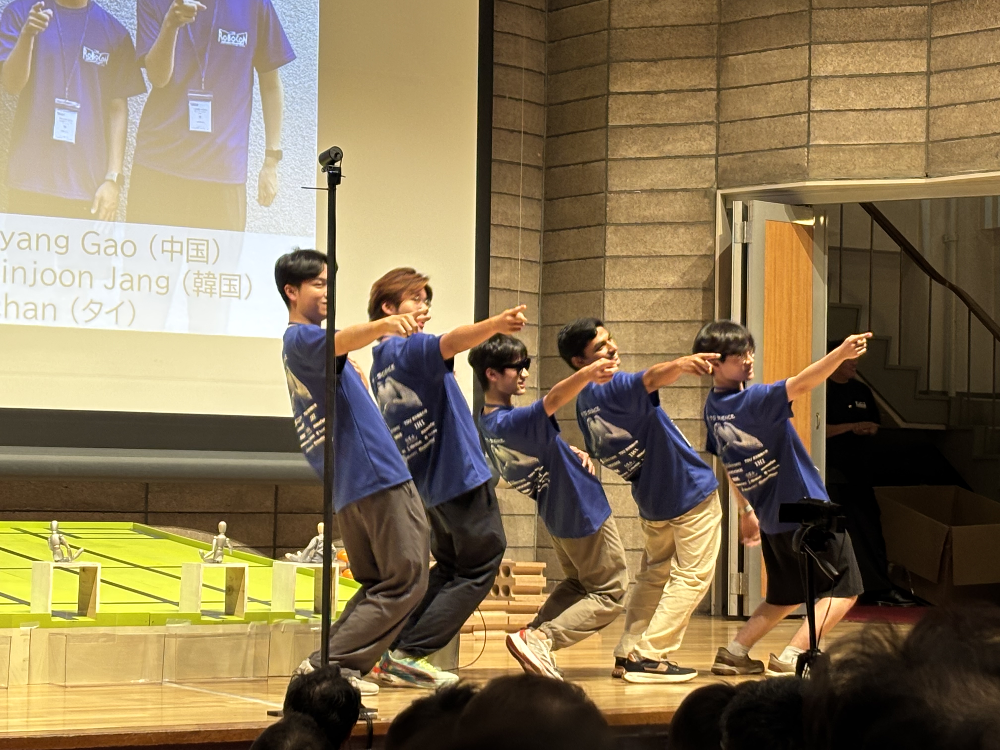
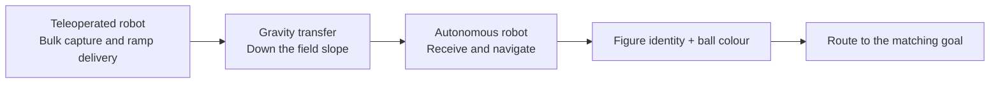

# IDC ROBOCON 2026 · Team Blue

**Design Prize · Autonomous robotics · Synthetic-data perception**

A two-robot system for *AI to Science*, built by a five-country team at the
Institute of Science Tokyo, Japan, **10–22 August 2026**.

[One-page profile](docs/portfolio/Minjoon_Jang_IDC2026_One_Page.pdf) ·
[Portfolio & award certificate](docs/portfolio/Minjoon_Jang_IDC2026_Portfolio.pdf) ·
[Engineering notes](docs/project-overview.md) ·
[Desktop examples](docs/getting-started.md)



## At a glance

| | Outcome |
|---|---|
| **Recognition** | Team **Design Prize**, using the wording on the official certificate |
| **My contribution** | **Minjoon Jang:** autonomous robot implementation and technical direction across the team |
| **Collaboration** | Five members from Korea, India, China, Japan and Thailand |
| **Perception** | YOLO11n trained on synthetic images; correct goal-figure identification in competition |
| **Autonomy** | Reached goal alignment in both preliminary matches |
| **Cyber game** | Full marks: **2 / 2** balls delivered to the correct goals |

This repository preserves perception and navigation modules, detector weights,
synthetic-data tooling, CAD generators and recovery notes. The competition Pi
was returned to the organizers; **this is an engineering archive and
reconstruction, not an exact backup of the deployed robot**.

## The idea

Orange balls belong in the human figure's goal; silver balls belong in the robot
figure's goal. The figures change sides each match, so the autonomous robot must
identify them before routing the balls.

Team Blue split the task into a pipeline: a custom teleoperated robot captures
balls in bulk, gravity carries them down the slope, and the autonomous robot
receives, identifies and sorts them.



The physical tournament ended in the preliminary round with **0 points**:
collector jams and inaccurate delivery prevented the two-robot handoff. The
design award, demonstrated autonomous behaviours and integrated match result
are separate outcomes. [Read the results and lessons](docs/project-overview.md).

## Engineering highlights

- **Synthetic-to-real perception.** The team report records approximately 18,000
  generated images across the project, with no real-image detector training.
  Venue photos informed scene calibration and evaluation. The preserved model
  notes describe a 7.7k-image training split for `dataset_v25`; these are different scopes.
- **Range-aware decisions.** Evaluation on 127 real venue photos reported 34/34
  correct silver-robot calls and 100% close-range classification. The close-range
  sample count was not recorded in the report. Goal verdicts are latched only
  at close range to avoid known far-range human-to-robot errors.
- **Integrated control.** ROS 2 on Raspberry Pi 5 connects camera-based lane
  following, ball-colour classification, goal selection and motor/servo control.
- **Mechanism design.** Extending arms, a passive single-file wedge and an active
  anti-jam flap convert rolling balls into a stream for sorting.

[Model details](models/README.md) · [Architecture and evidence](docs/project-overview.md)

## Explore the repository

| Directory | Contents |
|---|---|
| [ball_color/](ball_color/README.md) | Ball colour, lane tracking, team-side detection, arrival fusion and shared field constants |
| [nav/](nav/README.md) | Mission logic, steering, goal-side decisions, ROS wrappers and hardware drivers |
| [models/](models/README.md) | YOLO11n weights, ONNX export and IMX500 conversion artifacts |
| [dummy_model/](dummy_model/README.md) | Mannequin generation, MuJoCo pose sampling, Blender rendering and training tools |
| [cad/](cad/README.md) | Parametric autonomous-robot CAD generators |
| [docs/](docs/README.md) | Portfolio PDFs, overview, field specification and historical recovery notes |
| [Contest_Rules_final2026.pdf](Contest_Rules_final2026.pdf) | Official contest rulebook, version 1.01 |

## Try it without the robot

Run from the repository root with Python 3:

```bash
# Mission and steering logic: no third-party dependencies
python nav/test_logic.py

# Ball-colour classifier on five bundled sample crops
python -m pip install numpy pillow
python ball_color/ball_color_node.py --images "ball_color/samples/*.png"
```

These checks do not require ROS, cameras or motors. See
[getting started](docs/getting-started.md) for detector inference and the
remaining Raspberry Pi requirements. The launcher still requires a separate
detector publisher and calibrated, non-conflicting servo pins.

## Team and attribution

**Takato Inoue · Yuyang Gao · Koshy Prasanth · Minjoon Jang · Soravit Satechaichan**

Concept development was collaborative. Minjoon Jang implemented the autonomous
robot and helped guide the team's technical direction; the Design Prize belongs
to Team Blue. Software development used an AI coding agent, with engineering
strategy, calibration and operating-point decisions made by the team.

The [portfolio](docs/portfolio/Minjoon_Jang_IDC2026_Portfolio.pdf) includes the
original award certificate. Technical figures are team-reported; the
[documentation index](docs/README.md) distinguishes project outcomes from
historical notes and current checkout capabilities.
