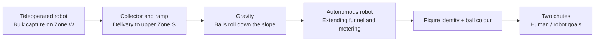

# IDC2026 Team Blue

### A two-robot system for *AI to Science*

**Design Prize · IDC ROBOCON 2026 · Institute of Science Tokyo, Japan · 10–22 August 2026**

[한국어](README.ko.md) · [Project report](docs/project_report.md) · [Evidence and provenance](docs/evidence.md) · [Hardware archive](hardware/README.md)


Five members from Korea, India, China, Japan and Thailand built two cooperating
robots: a teleoperated machine for bulk ball collection, and an autonomous
machine for vision-guided navigation and colour sorting. The design used the
field's slope to move balls between them under gravity.

This repository preserves perception and control software, the synthetic-data
pipeline, detector weights, selected fabrication files and the team's project
record. **The competition Pi was returned to the organizers; this is an archive
and partial reconstruction, with known deployment gaps.**

## Results

| Area | Outcome | Evidence scope |
|---|---|---|
| Design recognition | **Design Prize**, awarded to Blue Team | [Original certificate](docs/evidence/design-prize-certificate.pdf); no judging reasons or ranking stated |
| Cyber world game | **2/2 balls goaled** | Team-reported result |
| Physical tournament | **0 points in 2 preliminary matches** | Team-reported; no advancement |
| Bulk capture | All **55 balls** captured repeatedly in testing; approximately half and all in the two matches | Team-reported observation; extraction and delivery remained unreliable |
| Autonomous operation | Navigation, figure identification and goal alignment reported successful in both matches | No successful integrated scoring run; sorting demonstrated in testing |
| Figure detector | Synthetic-only training; close-range classification reported **100%** on the evaluated subset | [Real-photo study](docs/lr_field_report.html); close-range sample count not given; far-range errors remained |

Collector jams and uncontrolled ramp delivery prevented balls from reaching the
autonomous robot reliably. Its floorless containment also could not retain the
earned preload. The [report](docs/project_report.md) records the successful
subsystems and these limitations together.

## How the system works

Orange balls belong in the **human figure's goal**, silver balls in the **robot
figure's goal**. The figures exchange left/right positions between matches, so
the robot must identify them before routing balls. A goal with multiple balls
all of the correct colour receives a doubling bonus. Matches last three minutes.
See the [official rulebook](Contest_Rules_final2026.pdf) and
[field specification](docs/field_spec.md).



**Teleoperated robot.** An electromagnet releases a bottomless box over the ball
stack. Differential drive moves the captured group; geared collector motors
feed a ramp rising approximately 40 cm. This replaces the supplied Go2 platform
with a purpose-built machine, at the cost of a second complete build.

**Autonomous robot.** One servo deploys both capture arms from a 50 cm starting
envelope. An asymmetric wedge forms a queue, an anti-congestion flap breaks up
jams, and a sorting flap routes balls to two chutes. A Raspberry Pi 5 uses two
cameras for goal-figure recognition, lane following and ball-colour sensing.
Motion combines vision and timing; no wheel encoders were used.

## Synthetic data, real-field perception

The team report describes approximately **18,000 synthetic renders** generated
during the contest window. About **500 venue photographs** informed Blender
materials and lighting, rather than detector training. The pipeline combines
mannequin URDF generation, MuJoCo pose settling, Blender rendering and
occlusion-checked labels to train YOLO11n.

The [retained evaluation](docs/lr_field_report.html) covers 127 real venue
photos, with 97 scored after exclusions and 81 legal seated-pose frames:

- FP32 produced a usable, ground-truth-consistent reading in **69/81** seated
  frames (85%); the study's definition includes partial consistent readings.
- **34/34 silver-robot detections** were classified correctly. This is a
  detection count, not a claim of perfect recall.
- Close-range class accuracy was reported as **100%** at roughly 24–25% frame
  height. The subset size is not recorded; this is not overall accuracy on 127
  photos. The control logic uses a 25% close-range gate before latching sides.

An INT8 package for IMX500 was also built: **65/81** seated frames usable (80%).
The exact contest-day inference backend was not retained; the team report
suggests Pi CPU inference. [Model details and limitations](models/README.md).

## Repository guide

| Path | Contents |
|---|---|
| [ball_color/](ball_color/README.md) | Ball-colour classification, lane tracking, team-side and arrival sensing; shared field constants |
| [nav/](nav/README.md) | Testable steering, goal-side voting and mission logic, ROS 2 wrappers and motor/servo drivers |
| [dummy_model/](dummy_model/) | Synthetic-data generation, scene calibration, training and evaluation scripts |
| [models/](models/README.md) | YOLO11n PyTorch, ONNX and IMX500 conversion artifacts |
| [hardware/](hardware/README.md) | Supplied Fusion assemblies, selected STEP parts and DXF cutting files, with a source manifest |
| [cad/](cad/README.md) | Parametric CAD representation; dependencies and differences from the physical build |
| [docs/project_report.md](docs/project_report.md) | Strategy, mechanisms, match outcomes and engineering lessons |
| [docs/evidence.md](docs/evidence.md) | Source inventory, metric definitions, photos and reconstruction limits |
| [docs/field_spec.md](docs/field_spec.md) | Rulebook extraction and field geometry with provenance tags |
| [docs/pi_session_recovery.md](docs/pi_session_recovery.md) | Historical Pi-session recovery record and recovered notes |

## Try the preserved software

From the repository root, with Python 3:

```bash
# Steering, goal-side voting and mission checks: no third-party dependencies
python nav/test_logic.py

# Offline ball-colour demonstration: NumPy and Pillow
python -m pip install -r requirements-offline.txt
python ball_color/ball_color_node.py --images 'ball_color/samples/*.png'
```

The existing logic suite contains **25 checks**. The image demonstration labels
the two orange samples `orange`, the silver sample `silver`, and lime `none`.
White also reads `silver` without an empty-pocket reference: a known limitation
of colour-only classification. See the [calibration procedure](ball_color/README.md).

To inspect detector predictions, install Ultralytics separately and use:

```python
from ultralytics import YOLO

model = YOLO("models/dummy_yolo11n_v25f2.pt")
model.predict("your-photo.jpg", imgsz=640, conf=0.25, agnostic_nms=True)
```

The [navigation guide](nav/README.md) documents the archived Pi launcher and
topic contracts. The launcher requires ROS 2, camera/GPIO dependencies, an
external detector publisher and a verified hardware configuration. It does not
reproduce the full reported competition mission: the receiving-position
sequence and revised anti-jam mechanism are not implemented in this snapshot.

## Team and credits

The award certificate names **Takato Inoue, Yuyang Gao, Koshy Prasanth,
Minjoon Jang and Soravit Satechaichan**. Concept development was collaborative;
electrical assembly and wiring were shared across both machines. The supplied
portfolio attributes autonomous robot implementation and team-wide technical
direction to Minjoon Jang. Other individual roles are not assigned here because
the supplied record does not establish them.

The team report credits an AI coding agent used from the command line for
software implementation, with design strategy, calibration and operating-point
decisions made by the team. Photos, sketches and fabrication files come from
the supplied project folder; filenames and checksums are recorded in the
[evidence notes](docs/evidence.md). No new reuse license is assigned to code,
media, organizer documents or third-party models.
