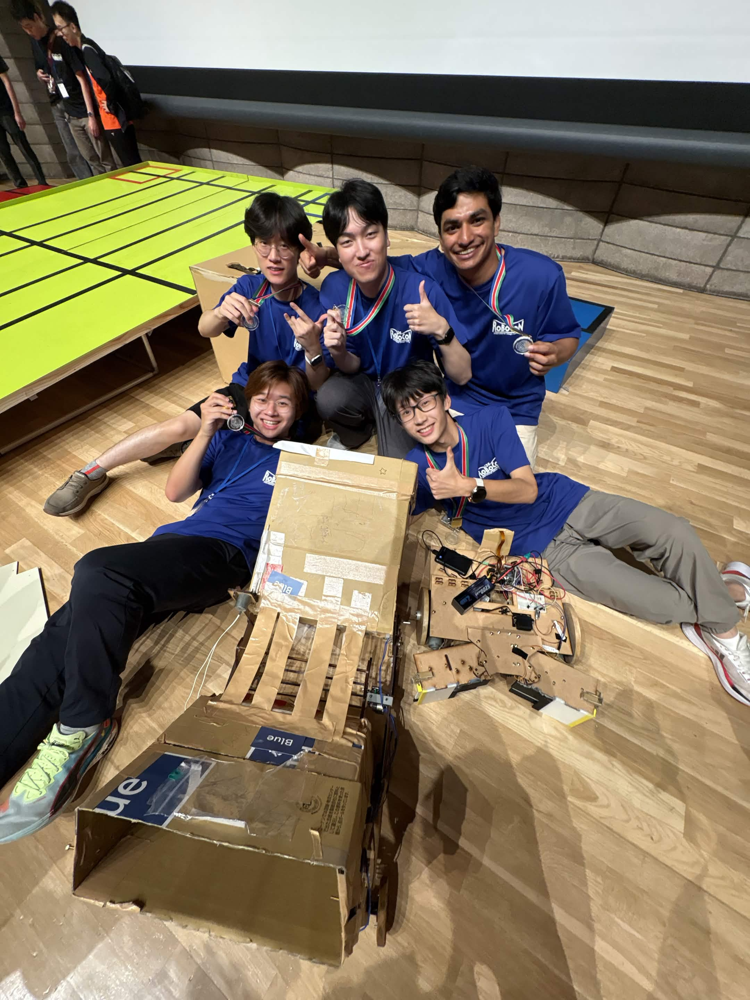
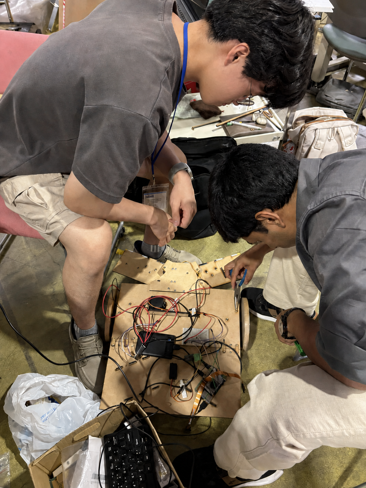

# Evidence and provenance

[Repository home](../README.md) · [Project report](project_report.md) · [Asset manifest](asset_manifest.json)

## Sources and editorial decisions

The project documentation was reconciled on 20 November 2026 using the supplied
IDC2026 folder and the retained repository. Documents in that folder are source
material, rather than instructions to execute or claims of current software
completeness. The edited report condenses the source report and qualifies claims
where the retained artifacts establish a narrower scope.

| Source | Used for | Handling |
|---|---|---|
| `IDC2026_TeamBlue_Project_Report_TeamVersion(1).md` | System concept, final mechanisms, development history and team-reported match outcomes | Edited into [project_report.md](project_report.md); source checksum in the manifest |
| [Design Prize certificate](evidence/design-prize-certificate.pdf) | Award title, named recipients, event dates and host | Copied unchanged; takes precedence over the report's “Best Design Award” wording |
| Supplied one-page profile and portfolio | Personal contribution and a cross-check of the team's account | Consulted; not duplicated in this team repository; checksums recorded |
| [Real-photo detector study](lr_field_report.html) | Evaluation populations, metric definitions and known failure modes | Existing dated evaluation preserved |
| [Model notes](../models/README.md) and conversion artifacts | Training lineage, export formats, INT8 results and memory fit | Existing artifacts preserved; deployment wording clarified |
| [Pi recovery record](pi_session_recovery.md), [field-day playbook](pi_field_day_playbook.md), [backlog](pi_sorter_backlog.md) | Recovered hardware facts and historical software limitations | Historical content retained; it is not proof of the final deployed state |
| [Official rulebook](../Contest_Rules_final2026.pdf) | Contest constraints | Existing organizer document; normative for rules |
| Supplied photos, sketches and fabrication files | Visual and mechanical project record | Selected byte-identical copies; origin, size and SHA-256 in [asset_manifest.json](asset_manifest.json) |

The source report referred to photographs named `IMG_5561.jpg` and similar, and
to eight `Presentation_Sketch-*` images that are absent from the supplied folder.
The edited report uses the available photos and two actual sketches, with new
captions; it does not relabel them as the missing originals.

The Design Prize certificate gives no judging rationale or “best overall”
ranking. The report's proposed explanations of the award are interpretations,
not statements by the judges. Likewise, preload entitlement was an opportunity
to score, not a guarantee of points.

## Metric definitions

| Claim | What the retained record supports | What it does not establish |
|---|---|---|
| Approximately 18,000 synthetic images | Team-reported rendering effort across the project | A complete retained dataset or an exact final training-split size |
| `dataset_v25` 7.7k train | Final model's documented training split | That every generated image trained the final model |
| Approximately 500 real photos | Team-reported scene calibration photography | Real-image detector training; the report says there was none |
| 127 real venue photos | Evaluation collection; 97 scored after exclusions | An independent untouched test set; calibration/evaluation overlap is not documented |
| 69/81 FP32 usable readings | Legal seated-pose frames; full or partial ground-truth-consistent readings under the study's definition | 85% object-detection accuracy or 69 complete two-figure decisions |
| 34/34 silver calls correct | Recorded silver-robot detections classified correctly | Perfect recall or 34 independent matches |
| 100% close-range classification | Reported accuracy in the close-range subset, about 24–25% frame height | Overall 127-photo accuracy; the close-range denominator is not specified |
| 65/81 INT8 usable readings | Separate 80% result in model conversion notes | FP32-equivalent performance or confirmed competition use |
| Successful autonomous operation in two matches | Team recollection of navigation, figure identification and goal alignment | An end-to-end scored delivery or complete match logs |

The photograph collection contains bursts and is small. No confidence interval
or claim of generalization to a new venue is added. The current 25%-height voting
gate is a code parameter; it should not be confused with an independently
measured distance threshold. Match results and physical test observations remain
team-reported because official score sheets and raw run logs were not supplied.

## What this repository can reproduce

| Component | Preserved state | Remaining gap |
|---|---|---|
| Steering, goal-side voting, basic mission logic | Pure Python modules and 25 existing checks | Checks exercise this reconstruction, not the entire original mission |
| Offline ball-colour demonstration | Classifier, configuration and five samples | No complete real-field validation set; white reads silver without a reference |
| Figure inference | `.pt`, `.onnx`, INT8 conversion outputs and example usage | Model runtime dependencies and a user-provided image are needed |
| ROS integration | Perception/control wrappers and `nav/launch_all.sh` | `/dummy_detections` publisher absent; no complete contest launcher preserved |
| Receiving mission | Physical sequence described in team report | `mission_logic.py` has no complete interception-position transit/wait sequence |
| Final anti-jam servo function | Described by report and mechanism account | `servo_node.py` implements a feeder gate rather than the final top-strike behaviour |
| Ball presence gating | Current reference-image approach; recovered depth-gate findings in historical notes | The original depth-gate implementation is not in the classifier |
| Motor wiring | Recovery note records BCM 12/17/13/23, reflected in driver defaults | Channel assignment, polarity and final trims require verification |
| Servo wiring and angles | Some angle contracts recovered from an earlier mechanism | Pins remain placeholders; earlier coupled arms/gate concept differs from final report |
| Field and camera geometry | Provenance-tagged constants and historical measurements | Nominal 20° design pitch differs from a reported effective 16.4° measurement |
| Synthetic-data generation | Core source and scene calibration settings | Generated datasets, pose caches and a locked full training environment are absent |
| CAD | Fusion sources, selected neutral-format files and parametric code | No proof of an exact final as-built assembly; generator requires external parts and `cadpy` |

The source report says the competition Pi was **returned to the organizers**.
Older recovery notes call the Pi “lost”; the lost item is the accessible deployed
source/configuration snapshot, not evidence of missing organizer property.
Some pin information was later recovered, so a blanket statement that all wiring
data is gone would also be inaccurate. The record cannot resolve whether
contest-day figure inference ran on the IMX500 or the Pi CPU.

## Photo and sketch gallery

*Team members and both robots. Source: `Picture_4.jpg`.*

*Workshop assembly and wiring. Source: `Picture_11.png`.*

| Sketch | Description |
|---|---|
| [Pipeline concept](images/pipeline-sketch.jpg) | Original receiving-position sketch; source `Picture_1.jpg` |
| [Sorting mechanism](images/sorter-sketch.png) | Original two-position sorter sketch; source `IdeaPresentation.png` |

The [README presentation photo](images/team-presentation.jpg) comes from
`Picture_6.jpg`. Captions describe visible context without identifying people
by appearance. Images are unchanged copies, including their original orientation
and resolution.

## Archive selection

The archive includes project-relevant technical files and the team award
certificate. Travel records, government-issued personal documents and the
student-number-bearing administrative report are excluded. The personal
portfolio is not substituted for the team report. Duplicate CAD caches,
approximately 94 MB assembly STEP exports, printer-specific jobs and the
third-party servo-model bundle remain outside this curated import.

The manifest records folder-relative origins without embedding the user's local
absolute paths. An artifact's inclusion does not establish authorship, a reuse
license, fabrication readiness or the exact version used in a match. The source
report and portfolio are identified by checksum but not published verbatim.
