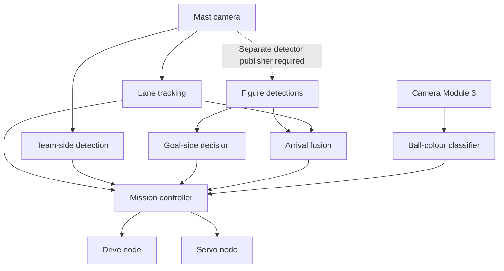

# Project overview

[Project home](../README.md) · [Documentation index](README.md)

## Challenge and design

IDC ROBOCON 2026 asked teams to deliver orange and silver balls to goals marked
by human and robot figures. Figure assignments changed every match. A correct
goal containing multiple balls of only the matching colour earned a doubling bonus.

Team Blue built a teleoperated collector and an autonomous receiver instead of
using the supplied Go2 quadruped as the teleoperated platform. The two machines
formed a pipeline, with gravity transporting balls down the field slope.

The autonomous robot combined a deployable V-funnel, passive single-file
metering, an anti-congestion flap and a colour-controlled sorter. Its cameras
supplied both goal identity and lane-following information.

## Minjoon Jang's role

Minjoon implemented the autonomous robot and helped guide technical direction
across the team. Concept generation was shared, and members worked across
subsystems. The award is a team achievement, not an individual award or a claim
of sole authorship of the entire system.

## Software architecture preserved here

Pure-logic modules are separated from ROS wrappers. Mission logic includes
timeouts, a jam watchdog and a policy for routing unclassifiable balls while
protecting the score bonus. The drive wrapper has a 0.5-second deadman.
Parameters are centralized in
[`ball_color/field_spec.py`](../ball_color/field_spec.py).

This diagram describes intended connections in the preserved stack. The
detector ROS publisher is not included, and current mission/servo code is
not a verified copy of the final contest implementation.

## Synthetic-to-real perception

The pipeline generated mannequin geometry, settled poses in MuJoCo and rendered
labelled Blender images with venue-calibrated materials and lighting. The team
report describes approximately 18,000 generated images across the project and
about 500 venue photographs for scene calibration, not detector training.

Model notes separately describe a **7.7k-image training split** for `dataset_v25`
and the `v25a → v25_full → v25f2` warm-start chain. These counts should not be
presented as the same dataset split.

| Reported evaluation | Result and scope |
|---|---|
| Real venue evaluation set | 127 photographs |
| Silver-robot calls | 34/34 correct across evaluated ranges |
| Close-range classification | 100% correct at approximately 24% bounding-box height; subset size not specified |
| Known failure | Human figures misclassified as robots at long range |
| Mitigation | Class-agnostic NMS, edge filtering and close-range latching |
| INT8 left/right verdict usability | 65/81, approximately 80%, versus approximately 85% for FP32 |

The INT8 export fits the IMX500 chip, but the exact contest-day backend was not
retained. The team report suggests Pi CPU inference. Export availability is not
proof that on-sensor inference was used in competition.

## Competition outcomes

| Area | Result |
|---|---|
| Award | Team Design Prize, as printed on the certificate |
| Cyber world game | Full marks: 2/2 balls delivered correctly |
| Autonomous behaviour | Correct figure identification and goal alignment in both preliminary matches |
| Sorter bench test | Correct handling of a continuous ball stream |
| Physical tournament | 0 points in two preliminary matches; no advancement |
| Integrated handoff | Not achieved: collector jams and inaccurate ramp delivery |

The earned preload could not be retained by the floorless mechanism. Navigation
and perception therefore did not translate into scoring: the receiver reached
the goals without a usable payload.

## Engineering lessons

1. **Test the robot-to-robot interface early.** The pipeline depended on a
   controlled landing zone, but the handoff was never tested end to end in practice.
2. **Match collection capacity to extraction throughput.** Capturing a large
   batch requires reliable metering before individual delivery.
3. **Budget time for integration.** A failed conveyor consumed roughly three
   fabrication days before being replaced by a passive ramp.
4. **Check interactions between requirements.** Floorless containment conflicted
   with preloading, while the electronics load exposed power limitations.
5. **Design around measured perception limits.** Close-range latching made the
   detector useful despite known errors farther away.

## Provenance

Outcomes are condensed from the team report and
[portfolio with certificate](portfolio/Minjoon_Jang_IDC2026_Portfolio.pdf).
The [model notes](../models/README.md), [evaluation HTML](lr_field_report.html) and
[recovery record](pi_session_recovery.md) document preserved evidence. Original
Pi code and real-run log folders are not included in this repository.
