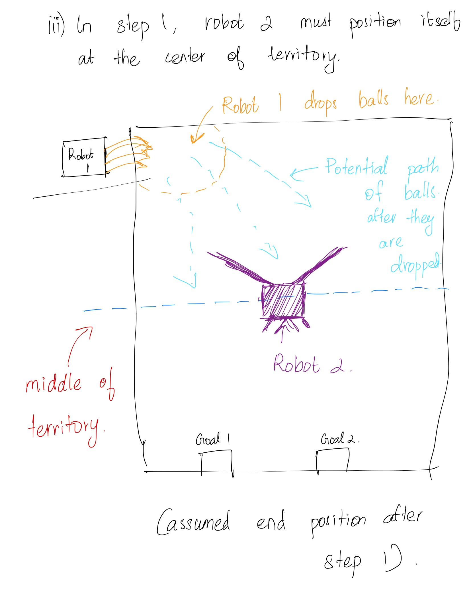
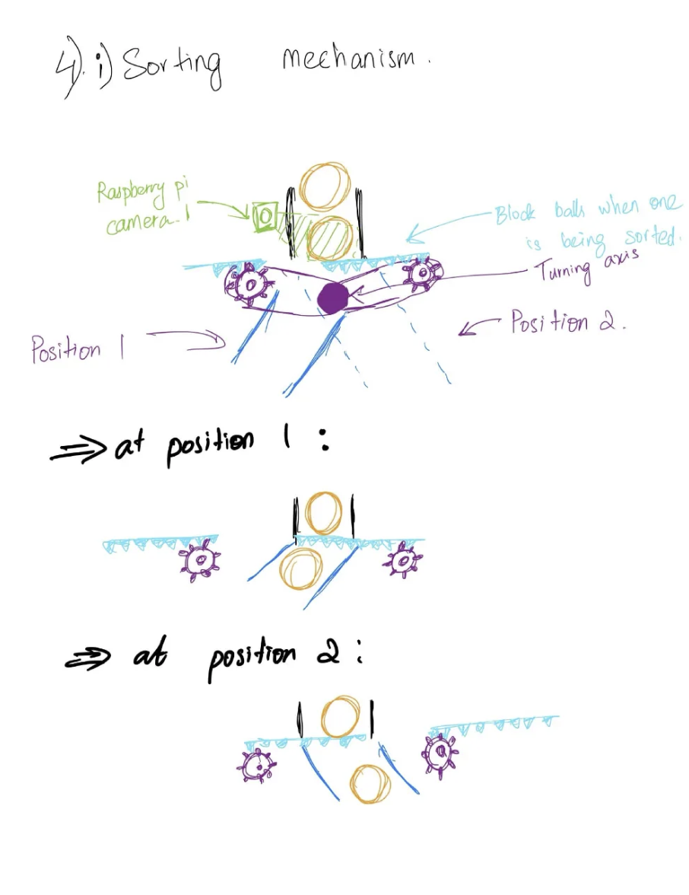

# Team Blue project report

## A two-robot system for *AI to Science*

**IDC ROBOCON 2026 · Institute of Science Tokyo, Japan · 10–22 August 2026**

[Repository home](../README.md) · [Evidence and provenance](evidence.md) · [Hardware archive](../hardware/README.md)

This edited report draws primarily on the supplied TeamVersion project report,
with award wording checked against the original certificate and software claims
qualified against the retained repository. Unless linked to a retained artifact,
match observations, measurements and development history are team-reported.
It describes the physical project; it is not a claim that the archived software
reproduces the complete competition system.

## 1. Contest and design constraints

The theme, *AI to Science*, connected scientific progress with care for humans
and robots. Orange balls represent care for humans; silver balls represent care
for robots. A ball scores one point only in the corresponding figure's goal.
If a goal contains multiple balls and all have the correct colour, that goal's
score doubles. The grey-clothed human and silver-painted robot figures change
goal positions each match and must never be touched by either robot.

The event brought together ten five-member teams from universities in seven
countries. Team Blue's members came from Korea, India, China, Japan and Thailand.
The team worked primarily in English, with translation tools when needed.

| Constraint | Design consequence |
|---|---|
| One autonomous and one teleoperated robot; three-minute matches | Split bulk handling from perception and sorting |
| Autonomous starting envelope: 50 cm cube | Deploy capture arms after the start |
| Teleoperated starting envelope: 50 × 80 × 80 cm | Use most of the available footprint for collection |
| Teleoperated robot barred from touching Zone S, Zone P and the slope | Keep its structure in Zone W; transfer balls across the boundary |
| Zone W approximately 20 cm above the floor; upper Zone S approximately 40 cm above Zone W | Lift or launch balls before gravity transport can begin |
| 55-ball stack and a sloping receiving field | Pursue bulk capture and a wide interception funnel |
| Randomized field side and figure assignment | Mirror motion configuration; perceive goal identities each match |
| Supplied kit and ¥2,000 purchased-materials allowance | Prefer passive geometry and shared actuators |
| Teleoperated control box: up to four DC motors, one electromagnet and one pneumatic actuator | Allocate two drive and two collector motors; use gravity for box deployment |

The [rulebook](../Contest_Rules_final2026.pdf) is the normative source. The
[field specification](field_spec.md) records extracted dimensions and uncertainty.

## 2. System strategy and teamwork

The supplied Go2 quadruped offered a ready-made mobile base. The team instead
built a complete teleoperated platform to capture many balls in one action.
According to the team report, Team Blue was the only one of ten teams to take
this route. That observation is not independently established by the award.

The intended sequence was:

1. Drop a bottomless collection box over the ball stack on Zone W.
2. Drag the captured group to the delivery position.
3. Extract balls and send them up a roughly 40 cm ramp to upper Zone S.
4. Let them roll downhill toward the autonomous robot.
5. Catch and meter them with an expanding funnel.
6. Navigate to the goals, identify the figures and sort balls into two chutes.

*Original concept sketch. Dashed paths express intended ball motion, not
measured trajectories.*

Concept generation and selection involved all five members. Fabrication then
split into teleoperated and autonomous streams, with vision and navigation
developed alongside the autonomous mechanism. Electrical work and wiring were
shared across both machines. The supplied portfolio identifies Minjoon Jang's
contribution as autonomous robot implementation and team-wide technical
direction; the source report does not give a complete individual task breakdown.

## 3. Teleoperated robot

### Configuration and bulk capture

The MDF/cardboard robot occupied nearly the 50 × 80 cm footprint allowance and
stood approximately 70 cm high. Two independently driven wheels provided
differential steering. Two collector motors used approximately 64:1 reduction
gearing. The pneumatic actuator was allocated but not used.

An electromagnet in a chassis slot held a bottomless cardboard box, about
40 cm long, in a raised forward-leaning position. Taped metal axles stiffened the
box and provided a ferrous contact surface. The operator aligned it over the
stack and switched off the magnet; gravity dropped the box over the balls.
The box stayed attached to the robot, corralling the balls against the table
as the machine moved. There was no powered reset for another drop.

This made bulk capture possible with one electromagnet and little moving mass.
The tradeoff was that balls were herded rather than supported: wall gaps could
leak balls, and dragging the group demanded substantial traction. Bonding rubber
to the wheels improved traction without fully resolving it.

### Conveyor iteration and ramp delivery

An early conveyor-belt lift consumed about three days of design, cutting,
assembly and rework without achieving reliable transport. The team replaced it
with a passive ramp and increased collector output speed to propel balls up the
incline. The chassis remained in Zone W while the ball path crossed to Zone S.

The box repeatedly captured all 55 balls in testing. Extraction remained the
bottleneck: balls wedged around the collector, rebounded into the captured
group, or escaped the box. A bulk input reached an extractor without a metering
stage. The autonomous robot's wedge and de-jamming flap suggested an available
approach, but it was not transferred to the collector before competition.

## 4. Autonomous robot

### Mechanisms

The autonomous chassis started inside the 50 cm cube. A single MG996R servo
deployed both arms through gear-and-rack mechanisms to form a wider V-funnel.
Walls retained balls against the field surface; the robot had no carrying floor
or preload hopper. Two driven MDF wheels provided differential steering.

The team report describes three servo functions in the final mechanism:

| Function | Final reported role |
|---|---|
| `s1` | Deploy both capture arms |
| `s2` | Strike congested balls from above to restart flow |
| `s3` | Sort the leading ball into one of two exit chutes |

An asymmetric wedge at the throat staggered incoming balls into a queue. A
servo originally assigned to metering was repurposed as the anti-congestion
flap when passive metering alone still jammed. The sorting assembly admitted a
leading ball, blocked the queue behind it and diverted it into a selected chute.
The report records correct continuous-stream sorting in testing, without a
retained throughput measurement.

*Presentation sketch of the sorting mechanism; it is not an assembly drawing.*

### Mission and navigation

The reported competition sequence was: clear Start A, turn and transit to the
interception position, face the delivery direction, extend arms, wait on a fixed
timer, receive balls, localize and identify the goals, descend using the black
lane markings, align between the posts, and sort. The wait time reserved enough
of the three-minute match for descent and sorting. A practice keyboard override
was not used in competition.

No wheel encoders or kit photo-reflectors were used. The robot combined camera
lane following with timed motion segments, calibrated using measured distances
and known-angle turns. Returning to Start A for the tie-break was not attempted.
The open funnel could not recover balls that rolled past its mouth.

**Archive distinction:** the retained mission logic begins with side sensing
and descent. It does not contain the complete receiving-position sequence above.
The retained servo wrapper also describes a feeder gate, rather than implementing
the final reported top-strike anti-jam function. See [reproduction limits](evidence.md#what-this-repository-can-reproduce).

### Compute, sensing and power

A Raspberry Pi 5 was the reported sole controller. An IMX500 camera on a mast
provided the field view; a Camera Module 3 observed the sorter throat. The team
used an 11.1 V, 5,200 mAh LiPo for motors and a 10,000 mAh Anker power bank for
the Pi. Motor drivers were MDD3A. The current geometry constants use 173 mm
wheel diameter and a camera pose of 300 mm height / 20° down-tilt; these are
documented reference values, not a newly verified as-built survey. Historical
notes also report an effective pitch near 16.4° after mounting.

The team report describes camera and GPIO interruptions under full load and a
contest-floor workaround involving disabled power protections. The exact setting
and electrical diagnosis were not retained and are not reproduced here. A future
build needs a measured load budget and adequate power delivery.

## 5. Perception and software

### Goal-figure detector

The figures differ mainly in finish: grey clothing on the human, silver paint
on the robot. The team took approximately 500 venue photos to calibrate Blender
materials and lighting. Training used synthetic images only, with approximately
18,000 renders reported across the project. The final model metadata separately
describes a 7.7k-image training split for `dataset_v25`; those counts describe
different scopes and cannot establish a complete dataset inventory.

The pipeline generated mannequin URDFs, settled seated poses in MuJoCo, rendered
the calibrated Blender scene, and emitted occlusion-checked labels. YOLO11n
`dummy_yolo11n_v25f2` was trained using a cloud RTX 5070 according to the report.
Development, calibration, training and conversion were completed during the
contest window, with an AI coding agent used for implementation.

The [retained real-photo analysis](lr_field_report.html) states:

| Metric | Result and scope |
|---|---|
| Photos considered | 127; 97 scored after exclusions, including standing-pose reference frames |
| Main legal seated subset | 81 frames |
| FP32 usable readings | 69/81 (85%); includes partial detections consistent with ground truth |
| Silver-robot class calls | 34/34 classified correctly; does not measure all missed robots |
| Close-range class accuracy | Reported 100% at about 24–25% frame height; sample count not specified |
| INT8 usable readings | 65/81 (80%), documented in model notes |

Far-range human-to-robot flips remained. The current control logic uses
confidence 0.25, cross-class duplicate suppression, a 3% edge filter and a
25%-height close-range gate before voting and latching the goal assignment.
The absence of a garment mesh in the synthetic human was identified as a likely
cause of the scale-dependent errors. A clothed model and far-scale augmentation
were proposed; this archive does not claim that retraining was completed.

The team reports correct figure identification in both physical matches. This
observation is separate from the offline validation metrics. The INT8 conversion
artifacts fit the IMX500 memory budget, but their existence does not establish
on-sensor inference on contest day. The report suggests Pi CPU inference;
the deployed backend remains unconfirmed.

### Lane and ball sensing

Lane detection estimates a centreline offset for PD steering and publishes lane
visibility. Start-tape sensing determines field side; arrival logic combines
visual evidence with mission state. Field-dependent values are centralized in
[`field_spec.py`](../ball_color/field_spec.py), with source and uncertainty tags.

Ball classification uses the throat camera. Silver is specular, so brightness
and colour vary with reflections and pocket lighting. The preserved classifier
uses colour statistics and can use an empty-pocket reference for presence
gating. White surfaces also classify as silver without that reference. Recovered
field-day notes describe additional depth gating in the original Pi code;
that implementation is not present in the current classifier.

### Preserved software structure

The repository separates testable logic from ROS 2 wrappers. Perception topics
feed goal-side voting and mission control; the mission publishes drive and servo
commands. The preserved navigation layer includes wait-state timeouts, a jam
watchdog and a 0.5-second motor deadman. Unknown balls route to a configured
lower-risk side, a heuristic intended to protect one goal's doubling bonus.
It does not guarantee the best scoring choice.

The existing dependency-free suite exercises 25 steering, goal-voting and
mission cases. These checks validate the retained logic, not the complete
competition build or its electrical configuration.

## 6. Competition record

| Event | Team-reported outcome |
|---|---|
| Cyber world game | Both balls goaled; full marks |
| Preload entitlement | Four balls (two orange, two silver), instead of the baseline two |
| Advancement | Did not reach the final four |
| Design recognition | Design Prize, confirmed by the original certificate |

The cyber advantage was unusable because the autonomous robot could not retain
preloaded balls in its floorless starting configuration. This forfeited a scoring
opportunity, not guaranteed points: the balls would still have needed to reach
the correct goals.

About an hour before the first match, spilled superglue seized a teleoperated
geared motor assembly. The team rebuilt it using replacement kit parts and
competed without forfeiting a match.

In the two matches the collection box deployed successfully and captured roughly
half the stack in one match and all 55 balls in the other. Extraction jammed.
Only about three or four balls were reported sent up the ramp across the
matches; they overshot or failed to reach Zone S usefully.

The autonomous robot reportedly reached its receiving position, deployed its
arms, navigated down the slope, identified the figures and aligned between the
goals in both matches. There was no reliable ball handoff and no successful
end-to-end scoring result. The lack of an end-to-end practice run left this
interface uncharacterized before competition.

The [certificate](evidence/design-prize-certificate.pdf) confirms **Design
Prize** for Blue Team. The supplied report uses “Best Design Award”; this edition
follows the certificate. A design presentation with questions took place around
days 2–3, but the judges did not provide a specific rationale. The award should
not be treated as proof of a particular design's ranking or technical validity.

## 7. Development timeline

| Phase | Approximate allocation | Work |
|---|---|---|
| Concept and presentation | 2–3 days | Collective ideas, selection, presentation and Q&A |
| Fabrication and integration | About one week | Both machines; approximately three days spent on the abandoned conveyor |
| Perception development | In parallel | Photography, scene calibration, rendering, training, validation and quantization |
| Arena practice | About 1.5 days | Shared field access, measurements and motion/camera tuning |

These are approximate overlapping phases within 10–22 August, rather than an
hour-by-hour schedule. Full two-robot integration testing was not completed.

## 8. Engineering lessons and next steps

| Finding | Practical next step |
|---|---|
| Bulk capture worked; extraction jammed | Add inlet metering and accessible jam recovery; measure balls per minute under full load |
| Ramp output missed the receiver | Measure launch speed, angle and landing spread; establish a receiving window before optimizing capture size |
| Two working subsystems did not produce a working handoff | Reserve end-to-end trials early, beginning with a small controlled ball stream |
| The conveyor absorbed a large share of fabrication time | Set a time-limited feasibility test and an explicit fallback criterion |
| Floorless containment prevented preload use | Check starting retention and release against the scoring rules before finalizing the chassis |
| Close-range recognition was stronger than far-range recognition | Keep abstention and close-range gating; collect an independently labelled evaluation set before retraining |
| Power and deployed settings were not fully preserved | Budget peak load and record wiring, settings, launch command and software revision with each test |

The shared design principle was geometric economy: an electromagnet and gravity
for capture, one servo for two extending arms, and an asymmetric wedge for
metering. The system-level lesson is that capacity, flow and interface accuracy
must be validated together.

## 9. What remains unknown

Neither robot's measured mass, a best practice score, sorting throughput nor
landing dispersion was recorded in the supplied report. The close-range
validation sample count, final contest-day inference backend and complete
deployed source/configuration are unavailable. Some motor wiring was recovered
from historical notes, but servo pin assignments and final trims still need
physical verification. Supplied CAD files are now indexed in the
[hardware archive](../hardware/README.md); their filenames do not prove an exact
match to the final assembled robot.
